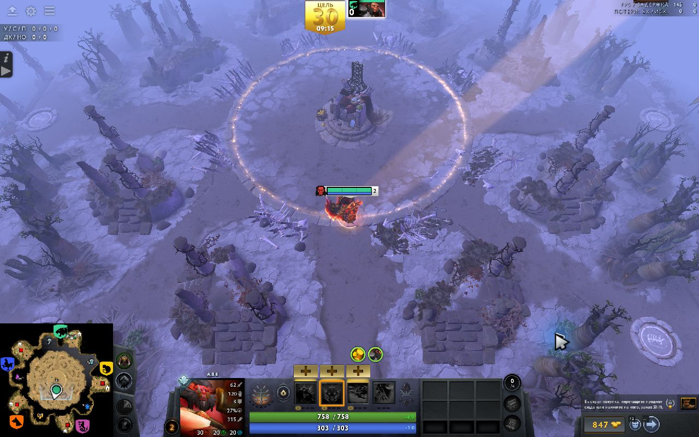
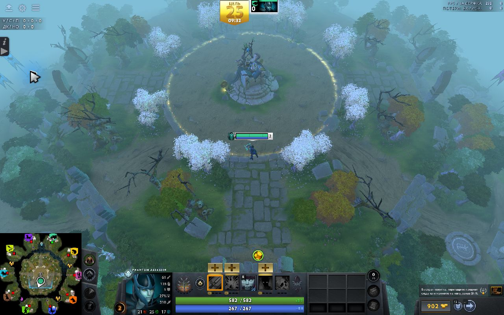

# Выбор основы арены — 2026-11-17

Выбрана **Valve Overthrow / Forest Solo**. Оригинальные файлы Overthrow не изменены; через штатный Create Addon сделана отдельная копия `duality_map_review`. Обе карты загружены в Dota, осмотрены центр и внешнее кольцо, выполнена выборка GridNav. Это не PvP-тест баланса.

| Критерий | Desert Duo | Forest Solo |
|---|---|---|
| Визуал | Песок, каменные мосты, пальмы и разрушенные колонны; в текущем освещении сильная фиолетовая дымка | Зелёная палитра, руины, цветущие деревья; более привычная читаемость эффектов Dota |
| Исходная организация | Пять крупных базовых секторов, по два игрока | Десять отдельных карманов для FFA |
| Входы и отступление | Выраженные проходы через воду; опасность усиления массового контроля в узких местах | Больше независимых входов, кольцевые обходы; деревья дают разрывы обзора |
| Переделка под восемь игроков | Потребовалось бы перестроить базовые площадки и доступ к мостам; просто добавить старты недостаточно | Можно сохранить геометрию и использовать общий набор безопасных точек появления |
| Размер | XY ±5632, 11264×11264 | XY ±5632, 11264×11264 |

Вывод о читаемости/балансе маршрутов — оценка по осмотру, а не измеренный винрейт. В финальной карте нужно уменьшить декоративную дымку и проверить крупные AoE в реальном бою.

## Фактическая проверка исходных карт

- Desert Duo: из 64 точек на радиусах 1300/2400/3500/4300 проходимы 44; 43 соединены с контрольной точкой, одна изолирована. Координаты всех баз отдельным тестом не измерялись.
- Forest Solo: проходима 51 из тех же 64 точек; соединены 43, восемь изолированы. **Все 50 исходных native стартов соединены с контрольной точкой.** Изолированные точки радиальной выборки не относятся к этим стартам; при переделке их нельзя автоматически объявлять игровыми площадками.
- Для обзора отключён туман войны и задана камера 2200; это только режим инспекции. Перемещения в обзорном сценарии — телепортация между ракурсами, не ручной обход каждого маршрута.
- Старый пример не запускался из-за явного ID 1001 у его предмета, конфликтующего с нынешним `shadow_demon_disseminate`. В отдельной копии удалено только это устаревшее назначение; движок назначает ID автоматически. В оригинальном Overthrow ID сохранён.
- Тестовой копии добавлен локальный `map_review.lua`, не включённый в игровой код Duality. Один синтаксический дефект тестового лога исправлен до итоговой проверки стартов.

## Перенос в Duality

`forest_solo` сохранён нынешним Hammer как отдельный `forest_duality_base.vmap` (vmap 40). Генератор `tools/build_arena.py` использует эту основу, не меняя высоты, воду, пути, деревья или gridnav flags; контрольный digest хранится в layout JSON.

Удалены старые базовые prefab с башнями/фонтанами/стартами, командные логотипы и баннеры, XP-юниты, трон, сундуки и старые частицы/игровые события. Добавлены восемь командных стартов, 12 точек безопасного появления и четыре места существующего артефакта. Сохраняются десять нейтральных магазинов и внешних карманов. Первое и последующие появления используют штатный для Duality выбор точки по безопасности; восемь командных стартов не создают постоянные защищённые базы.

Первая native сборка адаптации: **304 compiled, 0 failed**, установщик проверил 20 outputs. Адаптация отдельно прошла загрузку Duality, native 24/24 точки и три маршрута реального движения (4.8/22.4/32.0 с). Миникарта экспортирована движком и отображается после reload. Границы подтверждения — в TEST_RESULTS; результаты исходного Forest Solo не подменяют эти отдельные проверки.

Основа — выпущенные Valve исходники [Overthrow для Workshop Tools](https://www.dota2.com/reborn/part2/?l=english). Копируются и адаптируются для Dota 2, не объявляются полностью оригинальным ассетом Duality.
