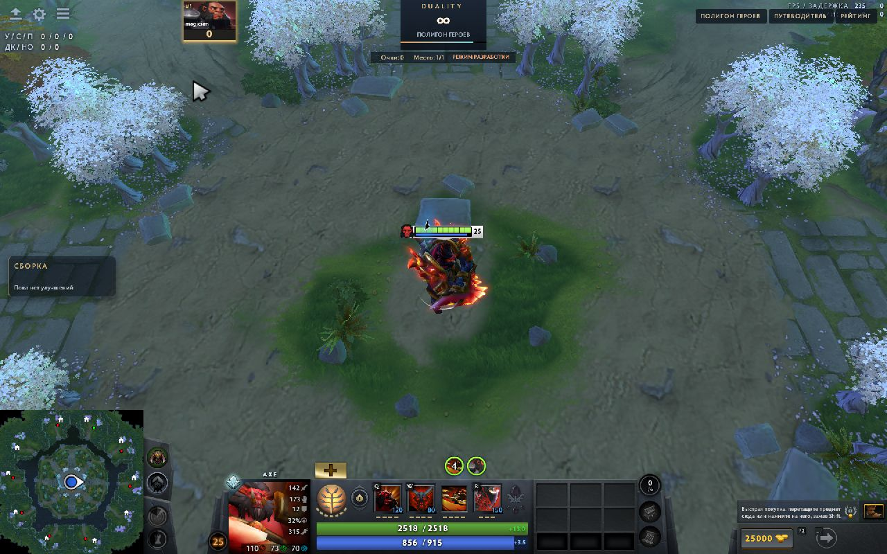

# Арена: только центральный остров и безопасные базы — 2026-11-17

По уточнению владельца внешнюю часть карты восстановили из резервной копии. Окончательная правка рельефа касается **только центрального острова**. Широкий вариант R=3840 отменён; он также разрывал семь подходов к базам и не принят как результат.

## Геометрия

- Центральное плато опущено до окружающего сухого пола Z=128. 185 изменённых вершин находятся в пределах 1949.64 от центра. Ограничивающая маска генератора R=2304; за ней рельеф совпадает с исходной версией. Не затронута ни одна вершина воды.
- Удалены 48 лестничных prop_static старого внутреннего плато и один центральный невидимый solid `materials/tools/toolsskip.vmat` (origin Z=395.43). До исправления герой останавливался за 226.65 от центра; после дошёл до (0,0,128), остаток 0.
- Вода, деревья, edgesPath, tile/material sets и gridnavFlags исходника не изменены. 55 прежних внешних authored nodes, включая магазины и внешние prefab, сохраняют позиции/параметры. Добавлены только маркеры восьми баз/башен.
- SHA256 внешних terrain data закреплён в build/check скриптах: `e72497041fc007c9b3a651a393c1e9bbab1268b9bca068466147fb7a4b930f89`. Генератор откажется принимать изменённую внешнюю геометрию как новый эталон.

## Безопасные базы

По согласованному правилу внутри своей базы запрещён входящий и исходящий урон и враждебные модификаторы, включая исходящий урон подконтрольных существ. База радиусом 650 даёт 20% максимальных HP и маны в секунду и сильное развеивание каждые 0.2 с. Внутри нельзя атаковать и применять способности. При выходе защита прекращается; чужая база защиты не даёт.

Восемь фиксированных домашних точек используются обычным первым спавном/возрождением. На fallback-карте dota базы не создаются, остаётся прежняя система выбора spawn. Автономная неуязвимая башня наносит 120 урона раз в секунду и отталкивает вторгшегося врага на 500 за 0.35 с; преследование ограничено окрестностью базы. Все характеристики в core/config.lua. Native CreateUnitByName для класса tower игнорировал начальную позицию; явный SetAbsOrigin исправил это, положение всех восьми проверено в игре.

## Фактическая проверка на ПК

- Полный перезапуск Dota/Tools после сборки текущей карты: **291 compiled / 0 failed**, свежий map VPK 11,931,124 bytes, **22 outputs** проверены установщиком. Backup: `20261117-122853-5913` в Dota/duality_backups/duality; исходная карта также в `C:/Games/anime/backups/20261117-base-terrain`.
- Native 113 выборок внутри R=1800: Z_min=Z_max=128. Центр traversable=true/blocked=false; герой реально дошёл в origin.
- **24/24** точки связаны именно с центром: 12 spawn candidates, восемь стартов и четыре артефакта. Положения всех восьми башен совпадают с маркерами; все базы соединены.
- Вход на свою базу через PlaceAtSpawn: снят заранее наложенный stun; за 1.1 с прибавилось 600 HP и 205 маны.
- Чистый урон 100000 внутрь, 1000 наружу, stun в обе стороны и 1000 урона настоящего контролируемого summon с owner=0 заблокированы. После выхода через 0.35 с модификатор отсутствует, исходящий урон снова проходит.
- Настоящая автоматическая атака башни вызвала knockback: при измерении враг отдалился на 428.58 (порог теста >400, до окончания перемещения).
- `dota_minimap_create` реально экспортировал обновлённую 512×512 миникарту; TGA скопирована в проект, геометрический digest зафиксирован. Native material перекомпилирован движком.
- Полный check.sh: **469 passed / 0 failed**, Lua/Node/UI/KV/DMX/карта/локализация/генераторы зелёные. Установщик: **191 mock checks** в PS5.1/7, включая ненулевую ошибку Write … Failed! при exit code 0.

[Фильтрованный лог до/после и измерения](operator_logs/2026-11-17_arena_revision.log).

## Границы проверки и оставшееся

Одиночный Tools lab с настоящими unit/modifier/ApplyDamage/attack не заменяет FFA на 2–8 игроках. Реальное возрождение в обычном многопользовательском матче, все крайние случаи принудительного перемещения/вражеских способностей/длительных эффектов и полный внешний обход магазинов не проверены этой сессией. Проверка PlaceAtSpawn подтверждает используемую позицию, а не весь цикл смерти/возрождения.

В native exporter встречаются штатные предупреждения `dota_create_minimap_ds.vtex` shader resource view; экспорт завершился и текстура создана. Новых Lua/Panorama ошибок в проверенных сценариях не обнаружено. Ранее при сборке открытая Dota блокировала запись VPK, хотя компилятор возвращал 0: установщик теперь считает `Write … Failed!` ошибкой. Финальная сборка выполнена с закрытой игрой. Существующие предупреждения косметики/локализации Dota не устранялись. Workshop не публиковался, index.html не менялся.
