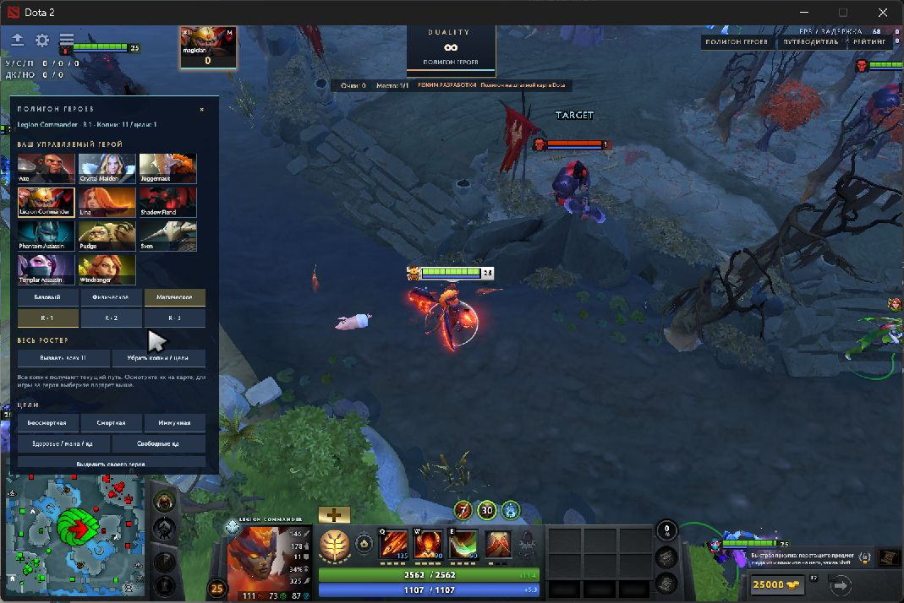
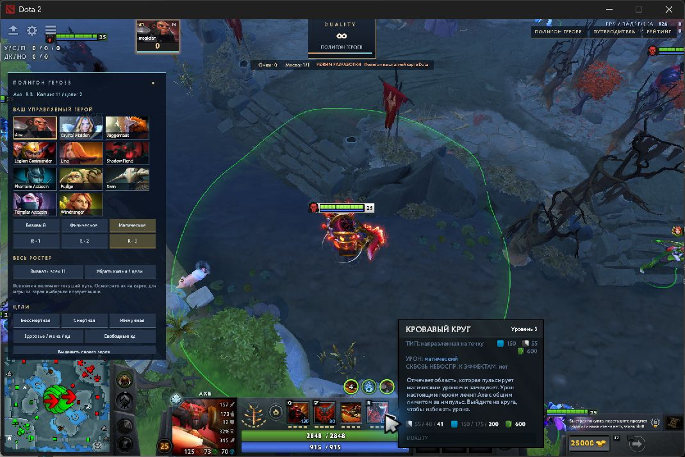

# DUALITY — локальная проверка 15–16 ноября 2026

Источник: `80a72b4a6e76576fbce2f3d136eeb328944a6c22`, ветка `claude/pensive-curie-zvybbg`.
Среда: Windows владельца, установленная Dota 2 + Workshop Tools, addon `duality`, карта быстрого полигона `dota`.

## Подтверждённая причина сломанного интерфейса

Исходники Panorama совпадали с репозиторием, однако на диске оставалась смешанная сборка:

- `rift_hud.vxml_c`: 2695 байт, старая разметка; новый XML — 8567 байт.
- JS/CSS уже были новыми, compiled `rift_ui_model.vjs_c` и `rift_lab.vjs_c` отсутствовали.
- В `console.log`: `Uncaught ReferenceError: RiftUIModel is not defined` в `rift_hud.vjs:12`, затем исключения при обновлении match state.
- Штатный `resourcecompiler.exe -dependency_check_only -v` сообщил `Input-dep CRC mismatch` и `Existing file invalid - Input dependency mismatch` для установленного `rift_hud.vxml_c`.
- Первая настоящая сборка выявила дополнительную ошибку, которую старый compiled файл скрывал: `rift_hud.xml(8,4): RESOURCE COMPILE ERROR: Found root panel with 'id' attribute, which is not permitted.`

Исправление: анонимная корневая панель, внутри неё прежний `RiftRoot`; установщик принудительно собирает model JS → HUD JS → lab JS → CSS → HUD XML → manifest XML. Для расширений JS/CSS/XML указаны реальные outputs `.vjs_c`, `.vcss_c`, `.vxml_c`. Флаги `-f`, `-nop4`, `-i`, `-game` проверены в `resourcecompiler.exe -help` на этом ПК. Код возврата и каждый свежий непустой output проверяются до запроса запуска Steam. Весь набор старых outputs сохраняется до первой компиляции, включая ресурсы, которые компилятор может пересобрать как зависимости.

На предыдущую установку выполнена настоящая пересборка: **6 Panorama + 2 собственных VFX, все успешно**. Полный перезапуск Dota выполнен. На экране появились верхняя Duality-панель, панель полигона с 11 портретами, кнопки путей и R1/2/3; native top bar скрыт. Владелец подтвердил, что интерфейс заработал.

## Вылет при выборе Axe

Владелец выбрал Axe в магическом пути: Dota завершилась. Два сохранённых дампа показывают `0xc0000005`, `particles.dll +0x1f156c`. Перед вылетом `console.log` сообщил nonresident модели косметики `models/items/axe/axe_winter_2025_*` после `ReplaceHeroWith`; Lua traceback отсутствовал. Это native-вылет, а не ошибка JavaScript.

Bootstrap загружал default unit resources. Выбор героя теперь сначала вызывает `PrecacheUnitByNameAsync(hero, callback, playerID)` и только после завершения меняет героя. Повторный выбор/ранг во время загрузки заблокирован; загрузка ограничена 30 секундами, опоздавшие callbacks игнорируются, при отказе/таймауте старый герой остаётся. Кеш ограничен 11 разрешёнными героями этой single-player сессии.

В новом запуске в логе зарегистрирован player-specific precache Axe, затем успешные base → physical → magical, каждый с R3. Магический вариант виден на скриншоте. В этой контрольной сессии повторного вылета и новых nonresident-ошибок Axe не наблюдалось. Без символов Valve точная внутренняя функция в `particles.dll` не установлена; загрузка косметики — подтверждённый пропущенный этап, устойчивость всех будущих конфигураций косметики не гарантируется этим одним прогоном.

## Проверка всех героев в коде

`bash tools/check.sh`: **342 passed, 0 failed**. На Windows команды Lua 5.1 выполнялись через локальный Lupa 2.8 runtime; код тестов не переписывался под другую версию Lua. JS syntax, KV/localization, регистрация 27 модификаторов, UI adapter, DMX, ссылки VFX и tooltip sync прошли.

| Герой | Base / physical / magical × R1/2/3 | Границы доказательства |
|---|---|---|
| Axe | 9/9 | Заглушка; выбор трёх путей дополнительно наблюдался в Dota |
| Crystal Maiden | 9/9 | Заглушка API |
| Juggernaut | 9/9 | Заглушка API |
| Legion Commander | 9/9 | Заглушка; native HUD и выбор наблюдались, новая crossfire в бою не проверена |
| Lina | 9/9 | Заглушка API |
| Shadow Fiend | 9/9 | Заглушка API |
| Phantom Assassin | 9/9 | Заглушка API |
| Pudge | 9/9 | Заглушка API |
| Sven | 9/9 | Заглушка API |
| Templar Assassin | 9/9 | Заглушка API |
| Windranger | 9/9 | Заглушка API |

99 сочетаний проверяют назначенного героя, новый экземпляр, удаление старого, отсутствие старой способности, направление, ранг видимой ульты на R, уровень 25 и отсутствие старого offer. 14 новых боевых путей проходят весь ограниченный цикл на каждом из трёх рангов (42 прогона), включая getters маны/кулдауна. Существующие тесты PA/TA/LC/SF, геометрии лучей, иммунитета, дедупликации, отмены, сессий и лимитов также зелёные. Дополнительные async-тесты проверяют ожидание player cosmetics, защиту от гонки, таймаут, поздний callback и ошибку API.

`tests/test_installation.ps1`: **92 checks** в Windows PowerShell 5.1 и PowerShell 7; mock process boundary проверяет все expected outputs, backup compiled layout, пути с пробелами, отказ на nonzero exit, отсутствующий/пустой/устаревший результат и manifest checksum. Это отдельно от выполненной настоящей ResourceCompiler-сборки.

## Открытые проверки

- Полный боевой playtest каждого героя и взаимодействия предметов/статусов; владелец продолжает ручную проверку.
- Новая LC magical: четыре видимых жёлтых пробивающих луча на каждом залпе, несколько real enemy heroes в одном луче, однократный учёт цели на залп, CDR по 2 секунды до нуля. Код и particle/texture compilation проверены; визуал и весь сценарий в Dota не отмечены выполненными.
- Immortal/mortal/immune targets, restore и free cooldowns полностью в игре не прогонялись.
- Собственная `rift_arena`: BUILD_MAP/Hammer/nav в этой сессии не выполнялись. Сборка fake map в installer tests не означает сборку настоящей арены.
- В штатной Dota остаются сообщения об отдельных отсутствующих stock resources/localization; в частности health label `TARGET` даёт localization warnings. Они не объявлены устранёнными.

## Сохранённые данные

До замены сохранены обе папки addon: `C:\Games\anime\duality-before-panorama-20261115-234317`.
Дополнительные backups установщика — `<Dota>/duality_backups/duality/20261115-*`.
Полные локальные logs/dumps/check outputs — `C:\Games\anime\test-results-2026-11-15`. Сырые дампы и telemetry не добавлялись в Git.
Короткие диагностические выдержки: [operator log](operator_logs/2026-11-16_panorama_axe.log).
`index.html` не изменялся; публикации в Workshop не было.
